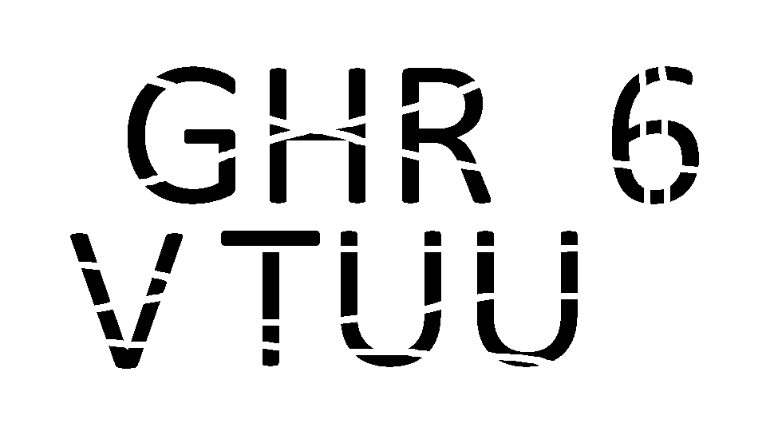

# Лабораторна робота №2. Програмування і алгоритми

**Виконала:** Ткаченко Валентина, група КМ-41

**Варіант:** DS6

**Мета роботи:** Розробити програмний засіб, який відображує за заданим датасетом точки на координатній площині і зберігає зображення в одному з графічних форматів.

## Використані засоби
- Мова програмування: **Python 3**
- Середовище: **Google Colab**
- Бібліотека: **Pillow (PIL)**, модулі `Image` та `ImageDraw`

## Хід роботи

### 1. Вибір і завантаження датасету
Мій логін на платформі «Сікорський» закінчується на 6, тому я взяла датасет **DS6**. Я завантажила файл DS6.txt у Colab і переглянула перші рядки командою `!head -5 DS6.txt`. У кожному рядку записано два цілих числа: координати x та y однієї точки.

### 2. Зчитування датасету з файлу
Для зчитування я написала функцію `read_dataset()`. Вона відкриває файл через `open()`, ділить кожен рядок на два числа методом `split()` і перетворює їх на цілі числа через `int()`. Кожну точку функція додає до списку методом `append()`.

```python
def read_dataset(filename):
    points = []
    with open(filename) as f:
        for line in f:
            parts = line.split()
            if len(parts) == 2:
                x = int(parts[0])
                y = int(parts[1])
                points.append((x, y))
    return points
```

Програма зчитала **53 542 точки**.

### 3. Створення полотна 960×540 пкс
Полотно я створила методом `Image.new()` з білим тлом, а потім методом `ImageDraw.Draw()` отримала об'єкт, яким можна малювати на цьому полотні.

```python
WIDTH = 960
HEIGHT = 540
image = Image.new("RGB", (WIDTH, HEIGHT), "white")
draw = ImageDraw.Draw(image)
```

### 4. Відображення точок у потрібній системі координат
У Pillow точка (0; 0) знаходиться у верхньому лівому куті, а вісь Y направлена вниз. За умовою потрібно, щоб (0; 0) був у нижньому лівому куті, Y ішла вгору, а X — праворуч. Тому я написала функцію `to_canvas()`: вона залишає x без змін, а y перераховує за формулою `HEIGHT - 1 - y`. Кожну точку я малювала методом `draw.point()` як один чорний піксель.

```python
def to_canvas(x, y):
    return x, HEIGHT - 1 - y

for x, y in points:
    draw.point(to_canvas(x, y), fill="black")
```

### 5. Збереження результату
Готове зображення я зберегла у файл формату PNG методом `image.save()`.

```python
image.save("result.png")
```

## Результат
Точки склалися в напис «GHR 6 VTUU». Напис не перевернутий і не дзеркальний, отже координати перетворено правильно.



## Використані методи
| Метод | Призначення |
|---|---|
| `open()` | відкриття файлу з датасетом |
| `split()`, `int()` | розбиття рядка і перетворення на числа |
| `Image.new()` | створення полотна 960×540 |
| `ImageDraw.Draw()` | створення об'єкта для малювання |
| `draw.point()` | відображення однієї точки |
| `image.save()` | збереження зображення у PNG |

## Висновок
У цій лабораторній роботі я написала програму на Python, яка зчитує датасет з файлу DS6.txt, малює точки на полотні 960×540 пікселів так, щоб (0; 0) був у нижньому лівому куті, і зберігає результат у файл result.png. Під час роботи я навчилася працювати з бібліотекою Pillow і зрозуміла, що в комп'ютерній графіці вісь Y зазвичай направлена вниз, тому координати потрібно перераховувати.

## Файли
- [lab2_DS6.ipynb](lab2_DS6.ipynb) — текст програми
- [result.png](result.png) — результат
- [DS6.txt](DS6.txt) — датасет
